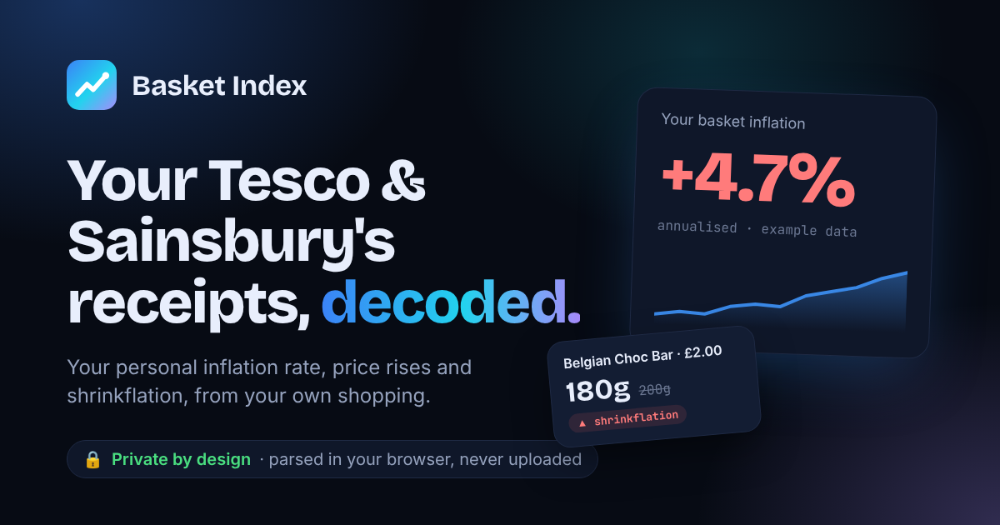

# Basket Index

[](https://github.com/thomaschaplin/basket-index/actions/workflows/ci.yml) [](LICENSE)

[](https://basketindex.thomaschaplin.me)

Cost-of-living insights from your own Tesco and Sainsbury's receipts. Drop in the PDFs (or the zip) and get your personal inflation rate, price movers, shrinkflation checks, pack-size value, staples, and every shop line by line.

**Try it:** [basketindex.thomaschaplin.me](https://basketindex.thomaschaplin.me). There's a built-in example if you don't have receipts to hand.

**Private by design.** Receipts are parsed in the browser with pdf.js and never uploaded. Names, addresses and card details are ignored. Your parsed receipts are kept in IndexedDB on your device only, so they're there next time; "Start over" clears them. A Content-Security-Policy stops the page from connecting to any other site, so the browser itself enforces this.

## What it shows

- **Basket inflation**: shelf price (before offers) of every product bought more than once, first vs latest, weighted by first-purchase quantity. Plotted as an index (100 = first shop) and annualised once the window is at least four weeks.
- **Insights**: auto-generated headlines (biggest riser, biggest faller, top category, offer savings, pack-size losses, most loyal buy).
- **Spend per shop / month**, paid vs saved by offers, and spend by category.
- **Price movers** with sparklines; offer purchases marked.
- **Shrinkflation watch**: a product family whose larger pack stops appearing and only a smaller, dearer-per-unit pack appears afterwards. Plus a pack-size value table with the best-value size and what not buying it cost.
- **Staples**, **biggest spends**, **offers that paid off**.
- **Product explorer**: search and filter every product, with full price history in a detail view. If a product lands in the wrong category, change it there; the choice is remembered on this device.
- **Receipts**: every order, expandable to its line items.
- **Receipt checks**: orders whose lines don't add up to the charged total (or, for Sainsbury's, whose item count doesn't match), whole-basket discounts, and Tesco's own "Including savings" figure vs the real line savings.
- **CSV export** of every line item, light and dark themes, and a one-minute console script for each shop to download all your receipts from tesco.com or your orders from sainsburys.co.uk.

## Stack

Vite, React 19, TypeScript, Tailwind CSS v4, Framer Motion, Recharts, pdf.js (lazy-loaded). Fonts are self-hosted, so the page makes no third-party requests.

```
src/lib/parser.ts        Receipt text -> { retailer, orderId, date, totals, items[] }. Detects Tesco or Sainsbury's
src/lib/analysis.ts      Receipts -> insights. All money in pence.
src/lib/categories.ts    Keyword categoriser
src/lib/storage.ts       IndexedDB key-value store for saved receipts and category corrections
src/lib/__fixtures__/    A fictional household's receipts as pdf.js-style text, generated by
                         scripts/generate-sample.ts. Used by the tests and as the in-app example.
src/lib/downloader-tesco.js       Console script that saves every receipt PDF from tesco.com/account/receipts as one zip
src/lib/downloader-sainsburys.js  The same for sainsburys.co.uk/gol-ui/my-account/orders: saves each order's details as JSON
src/components/          UI
scripts/generate-sample.ts   Regenerates the example receipts (deterministic)
```

## Develop

```sh
npm install
npm run dev        # http://localhost:5173
npm test           # parser, analysis and categoriser tests against the fixtures
npm run lint       # Biome: lint and formatting check (npm run format fixes)
npm run typecheck
npm run build      # type-check and build to dist/
```

The example data is made up: `npm run sample` regenerates it. It's a year of a fictional household's shopping (a big online shop every week or two, in-store top-ups in between, and fuel every few weeks) and deliberately includes price rises, two shrinkflation cases, a pack-size choice, loose produce, wrapped product names, seasonal buys, in-store order IDs and nameless till lines, fuel by the litre, a whole-basket coupon and one receipt that doesn't add up, so every part of the dashboard has something to show. Real receipts never go in the repo.

## Deploy

Vercel picks up `vercel.json` (Vite preset, output `dist`). Any static host works: serve `dist/`, and copy the headers from `vercel.json`, especially the Content-Security-Policy.

CI (`.github/workflows/ci.yml`) runs lint, type-check, tests and a build on every pull request.

### Content-Security-Policy

`connect-src 'self'` means the page can't send anything to another origin, and scripts load only from this site. That's why the set-the-theme-before-paint snippet is `public/theme.js` rather than an inline script. Styles allow `'unsafe-inline'` for the style attributes React and the charts set. If you add a script, font or request from another origin, the policy in `vercel.json` has to allow it.

### SEO and share cards

Canonical, Open Graph, Twitter card and JSON-LD tags live in `index.html` and use `%SITE_URL%`, which the build fills with an absolute origin: `https://basketindex.thomaschaplin.me`, or `SITE_URL` if set. The build also writes `robots.txt` and `sitemap.xml`; Vercel preview builds get a `Disallow: /` robots file so they stay out of search.

The share card (`public/og.png`, 1200×630) and the PNG app icons are rendered from `scripts/og-card.html` and `public/favicon.svg` with headless Chrome: `npm run og` (set `CHROME=/path/to/chrome` if it isn't found).

## Sainsbury's downloader

`src/lib/downloader-sainsburys.js` runs in the browser console while you're signed in on sainsburys.co.uk. It uses that signed-in session to save all your groceries orders into one zip for Basket Index. It only talks to sainsburys.co.uk.

1. **Checks where it's running.** Off sainsburys.co.uk, it tells you to open your orders page and stops.
2. **Picks up your sign-in.** The groceries API expects a `WCAuthToken` header, whose value is the `WC_AUTHENTICATION_<id>` cookie set at sign-in. The script sends that cookie as the header, as Sainsbury's own app does, and the browser sends the usual session cookies.
3. **Lists your orders** from the order history endpoint the website itself uses, `GET /groceries-api/gol-services/order/v1/order?page_number=…&page_size=50`, page by page. It stops when a page brings nothing new, when the reported total is reached, or after 40 pages. Set `SINCE = '2026-01-01'` at the top to skip older orders.
4. **Fetches each order's details** from `GET /groceries-api/gol-services/order/v1/order/{orderId}`: items, quantities, line prices, per-item offers (`adjustment`), coupons (`vouchers_savings`), delivery (`slot_price`) and totals. Each order gets up to 3 tries, waiting longer each time, with a short pause between orders. Cancelled orders, orders with no items and orders whose slot hasn't ended yet are skipped and logged.
5. **Trims each order down** to the order ID, status, type, slot time, totals, delivery, bag charge, coupons and savings, plus each item's quantity, unit, line total, product ID, name and offer amounts. The delivery address, payment card, Nectar details, receipt link, image links and everything else are dropped. Each order becomes one small file, e.g. `Sainsburys_Order_2026-10-09_1200000001.json`.
6. **Zips and downloads** them as `Sainsburys_Receipts_<today>.zip`, built uncompressed in the browser. One file avoids the browser's "multiple downloads" block.

### Why JSON and not the e-receipt PDFs

"Download e-receipt" links to a PDF on Amazon S3 through a signed link that expires after an hour. S3 sends no CORS header and no `Content-Disposition`, so a script on sainsburys.co.uk can't read the file, and opening the link only shows it in the PDF viewer. A server-side fetch would mean uploading data, which Basket Index doesn't do.

The order details hold the same information, with one difference each way:

- **Better:** each line's offer saving is listed separately (e.g. £4.00 reduced to £3.25 by a Nectar Price), where the PDF has one savings total for the whole order.
- **Missing:** Nectar points.

E-receipt PDFs downloaded by hand still work and can be mixed with saved orders. The same order from both sources is counted once, matched by order number.

### What Basket Index does with the zip

It unzips in the browser and reads each `.json` with `parseSainsburysOrder`. Shelf price is the price before offers, coupons come off the whole order, and the date is the delivery slot's date in UK time. Item lines plus delivery and bag charge, minus coupons, are checked against what was paid. Re-running the script and dropping the new zip doesn't create duplicates.

## Parser notes

### Tesco

- Line totals already include coupon deductions, so they reconcile with **Total**, not Subtotal.
- Loose produce (`… Loose`) shows price per kg as unit price; the line total is the weighed price.
- Tesco's "Including savings of" figure often under-reports the real line savings, so the app recalculates.
- Some receipts genuinely don't reconcile (lines vs charged total); these show up under Receipt checks.

### Sainsbury's

- Only groceries orders (delivery and click & collect) are supported. There are no digital in-store receipts to download.
- Two sources, both read by the app: the e-receipt PDF you download by hand from an order's page, and the order JSON the downloader saves.
- **Saved order JSON** (see [Sainsbury's downloader](#sainsburys-downloader)). Each line's `adjustment` gives its offer saving, so shelf prices are before offers, like Tesco. Catchweight lines (fractional quantity) are weighed. Slot times are UTC and dated on the UK calendar. There are no Nectar points.
- **PDF.** Each line has a quantity, a name and the price paid. Offers and Nectar Prices are one "You've saved" figure for the whole order, so they count towards your savings but not to any product, and shelf price is the price paid.
- Line totals are after offers but before coupons: they reconcile with **Total paid** − delivery + coupons. In a PDF, the "(28 items)" heading is checked against the quantities read.
- pdf.js returns the ff/fi/fl ligatures as separate text pieces ("Di ff user"), which the parser joins back up.
- Nectar points are valued at 0.5p each (Clubcard points at 1p). Card digits and the Nectar card number are ignored.
- The same product bought at both shops is tracked as two products, so switching shops doesn't show up as inflation.

## Contributing

Bug reports and pull requests are welcome; see [CONTRIBUTING.md](CONTRIBUTING.md). Please never attach real receipts. To report a security or privacy problem, see [SECURITY.md](SECURITY.md).

Basket Index is an independent project and isn't affiliated with or endorsed by Tesco or Sainsbury's. The downloader scripts use your own signed-in session on each shop's website; the shops can change their sites at any time, which may break them.

## License

[MIT](LICENSE)
